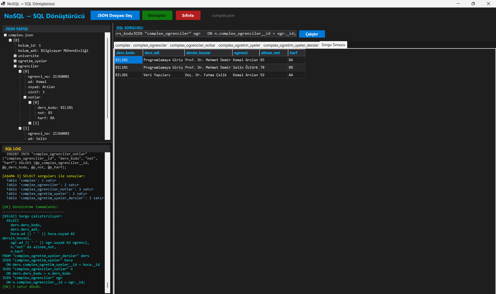

# NoSQL (JSON) -> SQL Converter

**[🇬🇧 English](README.md) | [🇹🇷 Türkçe](README.tr.md)**

A Windows Forms desktop application that converts hierarchical JSON documents into normalized relational SQLite tables. The system flattens 1:1 nested objects into parent table columns and maps 1:N arrays to separate child tables through foreign key constraints.



---

## Requirements and Execution

The project requires the **.NET 9.0 SDK** or runtime.

1. **Visual Studio:**
   - Open `240201025/Proje3.sln`.
   - Press **Start (F5)** to compile and run.

2. **Command Line Interface:**
   ```bash
   cd 240201025
   dotnet run
   ```

---

## Operating Instructions

The interface consists of a top control bar, a hierarchical JSON tree on the left, an execution SQL log panel on the bottom left, and a tabbed relational view with an integrated SQL query console on the right.

1. **Select JSON Document:** Click `JSON Dosyası Seç` (Select JSON) to load a `.json` file.
   - The tree view on the left renders the structural hierarchy of the document.
   - For arrays containing more than 50 elements, the tree renders the initial 50 nodes and appends a summary label for remaining entries to maintain responsive UI thread execution.
   - The `Dönüştür` (Convert) action is enabled upon parsing.
2. **Execute Conversion:** Click `Dönüştür`.
   - The engine initiates schema discovery, executes dynamic `CREATE TABLE` statements, and imports data using parameterized `INSERT INTO` queries within an explicit transaction.
   - Real-time diagnostic logs appear in the `SQL LOG` panel.
3. **Data Inspection and Querying:**
   - Tabs on the right display populated records within read-only data grids.
   - The `SQL SORGUSU` input supports `SELECT`, common table expressions (`WITH`), `PRAGMA`, and `EXPLAIN` statements. Executing a query routes output to a dedicated `Sorgu Sonucu` tab.
4. **State Reset:**
   - Click `Sıfırla` (Reset) to drop all user tables via `DropAllTables` and clear local buffers for subsequent runs.
5. **Interface Language Toggle:**
   - Click the `🌐 EN` / `🌐 TR` button on the top control bar to switch all interface controls, headers, and dialog prompts between English and Turkish at runtime without an application restart.

---

## Architectural Parameters and System Behaviors

Key configuration parameters and algorithmic constraints:

### 1. Database Location and State Persistence (`_databaseFilePath` in `Form1.cs`)
* **Default Value:** `proje3.db` located within the application execution directory.
* **Persistence Policy:** The engine retains existing `proje3.db` files between sessions, restoring schema tables on launch. If absent, a new database file is initialized.
* **Schema Reset:** The `Sıfırla` control clears existing tables via `DROP TABLE`.
* **Path Customization:** The path is set in `InitializeNewDatabase`.

### 2. Log Output Limiting (`_persistedRecordLogCount` in `Form1.cs`)
* **Default Value:** The first 100 insert operations are logged; subsequent statements are suppressed.
* **Rationale:** Direct serialization of high-frequency string updates to WinForms `RichTextBox` controls creates message queue overhead on the UI thread.
* **Adjustment:** Modify the boundary in `_persistedRecordLogCount <= 100` within `InsertRecordRecursive`.

### 3. TreeView Node Truncation (`previewLimit` in `Form1.cs`)
* **Default Value:** 50 elements per array level.
* **Rationale:** Hierarchical datasets containing thousands of array entries (such as `data.json` with 8,794 objects) generate over 300,000 WinForms `TreeNode` instances if parsed completely. Truncation bounds native Windows handle allocation while preserving structural visibility.

### 4. Prepared Statement Cache Management (`DatabaseManager.cs`)
* **Mechanism:** Insert statements are precompiled and cached in `_preparedInsertCommands`.
* **Cache Invalidation:** The cache is flushed before each conversion pass via `ClearPreparedCommands()`. This prevents stale parameter bindings when processing successive files with differing schemas without an explicit database reset.

### 5. Culture-Invariant Identifier Normalization (`JsonParser.cs`)
* **Mechanism:** All SQL identifiers undergo alphanumeric sanitization and lowercase conversion using `ToLowerInvariant()`.
* **Rationale:** Standard culture-sensitive casing in certain locales (such as Turkish dotted/dotless 'I') produces non-ASCII Unicode characters that fail SQLite ASCII case-insensitive column lookups.

### 6. SQLite Concurrency Pragmas (`DatabaseManager.cs`)
* **Configuration:** `PRAGMA journal_mode = WAL;` and `PRAGMA synchronous = NORMAL;`
* **Rationale:** SQLite default journal modes lock file descriptors during write operations. Write-Ahead Logging (WAL) decouples reading from writing, accelerating bulk inserts on local storage volumes.

### 7. Primary and Foreign Key Surrogate Identifiers
* **Design:** Primary keys use `_id` (autoincrement integer); foreign references use `{ParentTable}__id`.
* **Rationale:** Separating system surrogates with explicit prefixes prevents collisions with user keys (such as `id` or `ID`) present in input JSON models.

### 8. Grid Inspection Limiting (`LIMIT 500` in `Form1.cs`)
* **Default Value:** Preview grids load up to 500 records per table.
* **Rationale:** Direct data binding of multi-megabyte result sets to `DataGridView` components consumes substantial GDI resources. The total row count is logged separately via `SELECT COUNT(*)`, and unrestricted data remains queryable through the SQL console.

### 9. Runtime Interface Localization (TR / EN)
* **Mechanism:** Single-click UI language switching managed through `ToggleLanguage()`.
* **Design:** Retains Turkish as the default startup locale to align with institutional evaluation criteria, while providing instantaneous runtime translation of all interactive components, dialog prompts, and operational logs to English.

---

## Technical Pipeline and Complexity Analysis

### Component Architecture

| Pipeline Phase | Module and Method | Operation |
|---|---|---|
| **Pass 1: Schema Discovery** | `JsonParser.WalkForSchemas()` | Traverses the JSON token graph without persistence. Resolves table relations, column definitions, and type widening via `EnsureColumn()` and `PromoteType()`. |
| **Pass 2: Record Extraction** | `JsonParser.ProcessObject()` | Generates structured `FlatRecord` entities conforming to the finalized schema registry. |
| **Object Flattening** | `JsonParser.FlattenObject()` | Denormalizes 1:1 nested object structures into composite `parent_child` columns on the parent table, eliminating unnecessary relational joins. |
| **Array Normalization (1NF & 2NF)** | `JsonParser.ProcessArray()` | Isolates 1:N array collections into child tables, assigning autoincrement surrogate `_id` values and parent foreign keys (`parent__id`). |
| **Cached Statement Execution** | `DatabaseManager.InsertRecord()` | Binds record attributes to precompiled `SqliteCommand` templates within an open transaction context. |

### Time Complexity

Let **N** represent the total number of JSON tokens in the input document, and **M** represent the total number of relational records generated:

1. **Schema Discovery (Pass 1):** Scans each JSON token once: O(N).
2. **Record Extraction (Pass 2):** Extracts values from tokens in a single traversal: O(N).
3. **Database Persistence:** Batch insertion within a single transaction using prepared statement parameter updates achieves amortized O(1) runtime per record: O(M).

$$\text{Total Time Complexity} = O(N + M) = O(N)$$

Total runtime scales linearly with file size.

### Space Complexity

* **Memory Utilization:** The JSON model is held in memory as a `JToken` structure, yielding O(N) auxiliary space. Single-pass parsing via `ParseToken` prevents duplicate document copies.
* **Schema Metadata:** The schema dictionary stores table and column metadata proportional to O(T \times C), where T is the table count and C is the column count. This footprint is negligible relative to raw document volume.
* **Empirical Behavior:** A 14 MB document (e.g., `data.json`) consumes approximately 60 to 90 MB of process memory during traversal.

---

## Benchmark Datasets (`240201025/Samples/`)

The `240201025/Samples` directory contains four test configurations:

* `simple.json`: Single-tier object model with primitive scalar values.
* `nested.json`: Multi-tier object hierarchy containing nested attributes and order line arrays.
* `complex.json`: Deeply nested university data model encompassing departments, faculty, course schedules, and student enrollments.
* `data.json`: Large-scale real-world benchmark (14.3 MB, 8,794 mobile hardware records) featuring deep specifications (`specs`) structures, serving as a stress test for memory management, flattening, and bulk insertion.

---

## Dependencies

* [.NET 9.0](https://dotnet.microsoft.com/)
* [Newtonsoft.Json (13.0.4)](https://www.nuget.org/packages/Newtonsoft.Json/): JSON token traversal and serialization.
* [Microsoft.Data.Sqlite (10.0.8)](https://www.nuget.org/packages/Microsoft.Data.Sqlite/): SQLite database engine driver.
